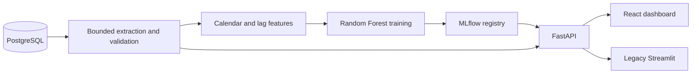
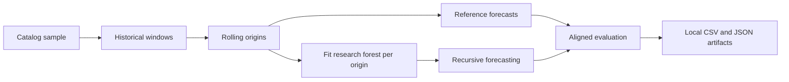

# DecisionOS architecture

The [production deployment notes](docs/architecture/production_deployment_architecture.md) describe ongoing work and its limitations. Existing local JSON persistence remains in use.

DecisionOS uses a historical PostgreSQL sales database, Python feature and forecasting pipelines, MLflow tracking and registry, FastAPI services, and a React interface. Streamlit remains a legacy fallback. Simulated replenishment and a budget-allocation heuristic are implemented; cloud deployment and production-grade optimization infrastructure are not.

The data layer validates finite nonnegative observations, unique pair-date keys and continuity within each series. Training features use grouped lag and rolling calculations. The model contract in `src/decisionos/ml/train.py` orders 14 features. Inference rebuilds the same columns and feeds each prediction into subsequent lag history. The hybrid policy chooses historical mean only for a zero-average history and Random Forest for other segments.

Batch forecasts resolve a catalog scope, enforce pair and row limits, extract aligned histories and aggregate eligible pair predictions. The API caches the registered model and exposes coverage and exclusions. The primary React frontend calls FastAPI. Configuration is centralized in `src/decisionos/config.py` and credentials stay in local environment settings. Liveness is distinct from database and model readiness.

Research code under `src/decisionos/evaluation/` and `experiments/forecasting/` runs separately from model serving. An optional MLflow flag records completed research runs and artifacts in a separate experiment. The 60-pair run and its recorded artifacts were verified. The React model view does not display these artifacts. CI runs Python and frontend checks. Broad PostgreSQL aggregation and CPU inference are limited by query latency, memory and synchronous workload limits. See the [performance plan](docs/engineering/analytics_performance_plan.md), [frontend architecture](docs/engineering/frontend_architecture.md), and [research protocol](docs/research/v1_4_1_experiment_protocol.md).

The research runner now performs train-only stratified sampling, per-series RMSSE and aligned hierarchy summaries. The completed 60-pair run used a separate MLflow research experiment. Raw predictions and charts are stored locally under the ignored research output directory and recorded as research artifacts. The candidate model alias remains version 1.

V1.4.2 adds a separate versioned experimental feature contract and a research-only ablation runner. Dynamic demand features are built by one shared training/inference function; the production 14-column interface remains unchanged. Calendar and SNAP are scheduled covariates, while price is restricted to completed historical weeks and frozen at origin. Feature lists, fold metrics and outputs are recorded in separate MLflow experiment 3. [Protocol](docs/research/v1_4_2_feature_engineering_protocol.md)

## Scope decision

DecisionOS is scoped as a predictive and prescriptive retail intelligence platform with production ML engineering. The earlier roadmap considered retrieval and agentic capabilities as potential future extensions. The user has moved those capabilities to a separate Generative and Agentic AI project. Modular FastAPI endpoints remain the boundary through which an external system may consume DecisionOS capabilities. This decision does not add an integration layer or alter existing serving behavior.

The planned sequence is V1.4.3 adaptive forecasting and a research checkpoint, independent candidate evaluation and user-approved integration, V1.4.4 uncertainty, V1.4.5 scalable persisted forecasts, V1.5 risk intelligence, V2.0–V2.3 inventory and decision intelligence, and V3.0–V3.3 deployment, MLOps, monitoring and cloud release.
V1.4.3 adds research-only hurdle and pooled direct forecasting under `src/decisionos/evaluation/optimization.py` and a bounded optimization runner under `experiments/forecasting/`. A development-selected lock defines the methods used on a separate chronological holdout. Results and source snapshots are tracked in MLflow experiment 4. The research policy is not connected to the FastAPI serving path. [Research protocol](docs/research/v1_4_3_optimization_protocol.md)

Predictive services add selected statistical methods, pair-level residual intervals, bounded chunked runs and local atomic run snapshots. A separate risk route exposes descriptive pair-level demand and price signals. The [predictive architecture](docs/architecture/predictive_intelligence_architecture.md) describes status, persistence and limitations. PostgreSQL source tables remain unchanged.

The simulated prescriptive module validates complete single-pair saved forecasts and dates, uses explicit inventory and cost assumptions, and produces deterministic recommendations, budget allocations, scenarios and historical policy replays. Simulated reviews are local JSON records. The [prescriptive architecture](docs/architecture/prescriptive_intelligence_architecture.md) documents the boundaries. No PostgreSQL schema change or purchase execution was added.
