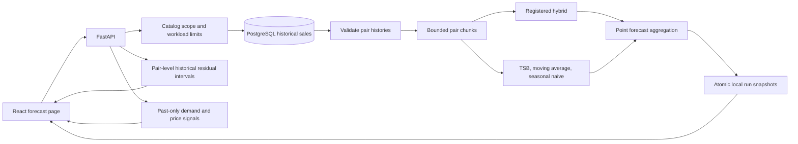

# Predictive intelligence architecture

PostgreSQL stores existing source data. Run snapshots currently use a local directory controlled by `DECISIONOS_FORECAST_RUN_DIR`, defaulting to `forecast_runs/` under the project root. Files are excluded from Git. No schema change or migration is applied. Snapshots are not an authenticated or multi-host database. Back up the directory if run history matters.

Execution remains synchronous and bounded by existing pair and row limits. Chunk size is 1–100 and defaults to 50. Status writes are atomic file replacements, and no incomplete chunk forecast is presented as a complete run. Eligibility exclusions are returned with a completed run. A failure after some chunks records a failed status and completed-pair count. Process termination can leave a running status that requires operational review. There is no worker queue or automatic restart.

Uncertainty is provided only for a single pair. Summing marginal interval bounds does not yield a calibrated aggregate interval. Demand and price signals are descriptive statistical alerts, with no real-world fraud or stockout attribution.
