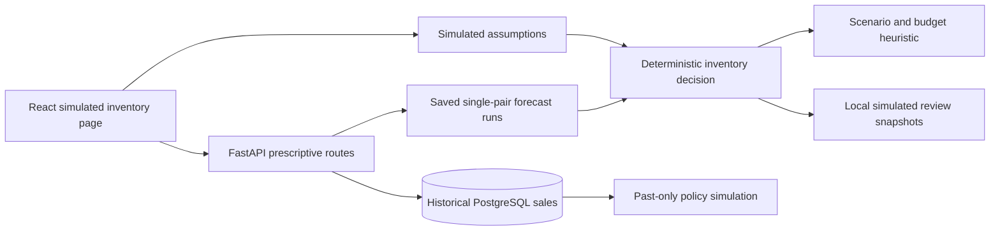

# Prescriptive intelligence architecture

The service validates that a saved run is complete, covers one explicit pair, and contains a contiguous forecast starting the day after its recorded origin. It checks that the forecast covers lead time plus seven review days. It reuses saved point forecasts and keeps model URI and version in the response. It never sums marginal prediction interval bounds or treats them as calibrated stockout probabilities.

Inventory and costs are user-supplied or generated deterministically from product, store and a seed. They are simulated and are not stored as business facts. Users can optionally save them as local atomic JSON records in ignored simulated_inventory/; the latest write replaces the prior simulated pair record. Reviews are atomic local JSON snapshots in ignored `decision_reviews/`; their status means simulated review only. There is no external purchase or database schema change. The allocation is greedy and bounded to 20 pairs. Historical simulation is bounded to 90 observed days for a single pair.

The existing FastAPI error boundary handles unexpected failures. A production system would need authenticated users, transactional durable persistence, actual inventory and receiving events, cost and currency sources, audit history and concurrent update rules.
